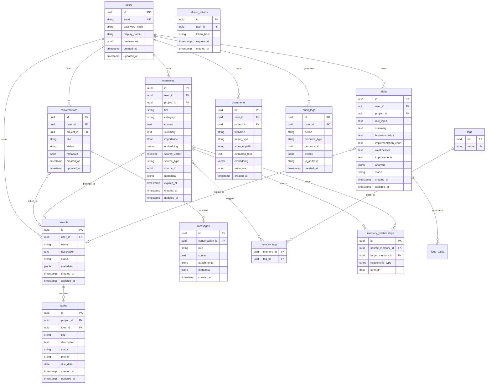

# MOBIUS Database Schema

PostgreSQL 16 with `pgvector` extension.

## Entity Relationship Diagram



## Memory Tiers

| Tier | Code | Retention | Use Case |
|------|------|-----------|----------|
| Working | `working` | Session | Current conversation context |
| Short-Term | `short_term` | 72 hours | Recent interactions |
| Long-Term | `long_term` | Permanent | Important facts, preferences |
| Project | `project` | Project lifetime | Architecture, goals |
| Semantic | `semantic` | Permanent | Embedding-indexed knowledge |
| Archived | `archived` | Permanent (cold) | Low-importance historical |
| Reflection | `reflection` | Permanent | Consolidated insights |

## Indexes

```sql
-- Vector similarity (HNSW for performance)
CREATE INDEX idx_memories_embedding ON memories USING hnsw (embedding vector_cosine_ops);
CREATE INDEX idx_documents_embedding ON documents USING hnsw (embedding vector_cosine_ops);

-- Full-text search
CREATE INDEX idx_memories_search ON memories USING gin (search_vector);
CREATE INDEX idx_documents_text ON documents USING gin (to_tsvector('english', extracted_text));

-- Query patterns
CREATE INDEX idx_memories_user_tier ON memories (user_id, tier);
CREATE INDEX idx_memories_importance ON memories (user_id, importance DESC);
CREATE INDEX idx_messages_conversation ON messages (conversation_id, created_at);
CREATE INDEX idx_ideas_user_status ON ideas (user_id, status);
```

## Migration Strategy

Alembic manages schema evolution. Each phase adds migrations incrementally without breaking existing data.
