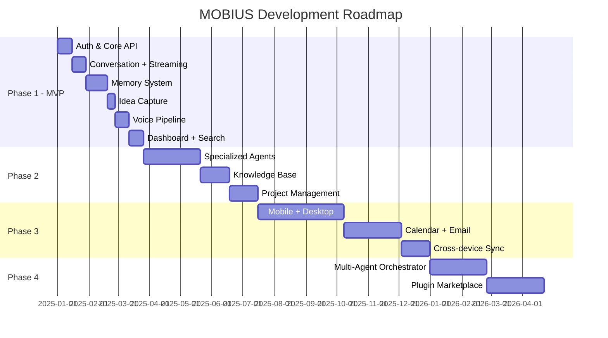

# MOBIUS Implementation Plan

## Phase Overview

## Phase 1 — MVP (Current)

**Goal**: Working personal AI OS with conversation, memory, ideas, voice, dashboard, and search.

### Deliverables

| Feature | Status | Components |
|---------|--------|------------|
| Authentication | ✅ | JWT, register/login, refresh tokens |
| Conversation | ✅ | REST + WebSocket streaming, multi-provider LLM |
| Memory | ✅ | CRUD, tiers, embeddings, semantic retrieval |
| Idea Capture | ✅ | Trigger detection, analysis, task generation |
| Voice | ✅ | STT upload, TTS generation endpoints |
| Dashboard | ✅ | Focus, tasks, memories, ideas, recommendations |
| Basic Search | ✅ | Hybrid memory + conversation search |

### Acceptance Criteria

- [ ] User can register, login, and receive JWT tokens
- [ ] User can have streaming conversations with context from memories
- [ ] MOBIUS stores and retrieves relevant memories semantically
- [ ] Saying "I have an idea" triggers structured idea capture
- [ ] Voice input transcribed and voice output generated
- [ ] Dashboard shows today's focus, recent items
- [ ] Search returns relevant memories and conversations
- [ ] Docker Compose brings up full stack
- [ ] CI runs tests on push

## Phase 2 — Intelligence Layer

- Coding Agent with repo context
- Architecture Agent with diagram generation
- Research Agent with document ingestion
- Knowledge Base (GitHub, Notion, local folders)
- Project Management (roadmaps, sprints, tasks)

## Phase 3 — Platform Expansion

- Android app (Flutter)
- Desktop app (Tauri)
- Calendar integration (Google, Outlook)
- Email assistant (read-only + draft)
- Push notifications
- Cross-device sync

## Phase 4 — Autonomous OS

- Multi-agent orchestrator
- Autonomous planning loops
- Plugin marketplace
- Reflection engine
- Advanced analytics
- Proactive notifications

## Incremental Development Rules

1. **Ship working slices** — Each PR delivers a testable feature
2. **No placeholder logic** in completed features
3. **Document decisions** in ADRs when trade-offs matter
4. **Test as you go** — Unit tests for services, integration for API
5. **Keep plugins in mind** — Don't hardcode integrations

## Architecture Decision Records

### ADR-001: PostgreSQL + pgvector over ChromaDB

**Context**: Need vector search + relational data in one place.

**Decision**: Use pgvector extension in PostgreSQL.

**Consequences**: Single database to manage; slightly less specialized vector performance than dedicated DBs; simpler ops.

### ADR-002: Provider abstraction for LLMs

**Context**: Support OpenAI, Anthropic, Gemini, Ollama.

**Decision**: `LLMProvider` protocol with registry and fallback chain.

**Consequences**: Easy to add providers; small abstraction overhead.

### ADR-003: Next.js App Router for frontend

**Context**: Need SSR, PWA, fast dashboard.

**Decision**: Next.js 15 with App Router, Tailwind, dark-first design.

**Consequences**: Modern React patterns; Vercel-friendly deployment.

### ADR-004: Feature-based backend modules

**Context**: Long-term extensibility with agents and plugins.

**Decision**: Clean architecture with domain/application/infrastructure/api layers per feature.

**Consequences**: More folders; clear boundaries for future agents.
