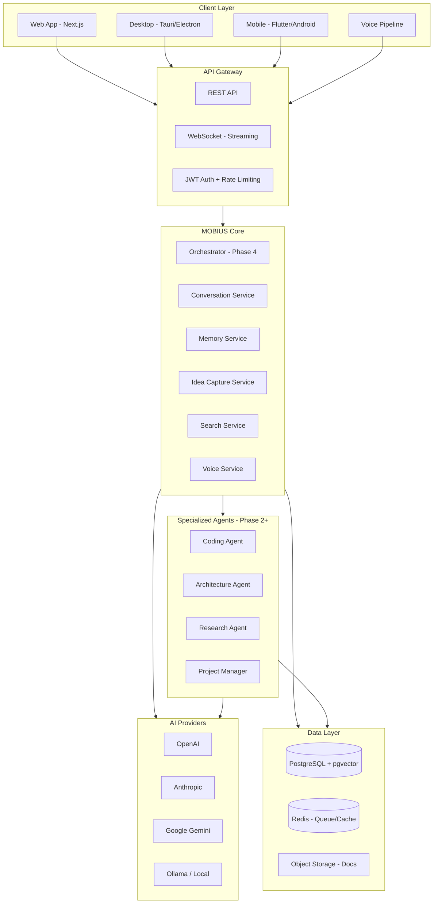
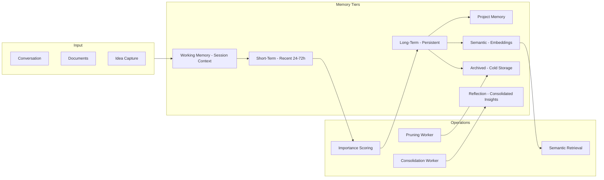
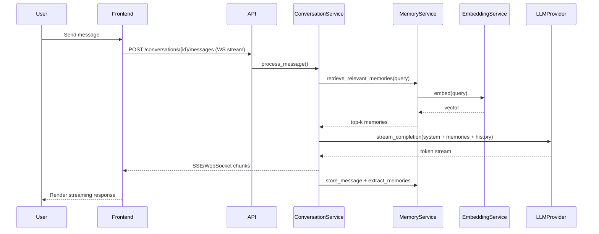

# MOBIUS — System Architecture Overview

## Vision

MOBIUS is a personal AI operating system: a modular, secure, extensible platform that acts as a second brain, advisor, and intelligent partner—not a chatbot.

## Architectural Principles

| Principle | Decision | Trade-off |
|-----------|----------|-----------|
| **Modularity** | Feature-based modules with clean boundaries | Slightly more boilerplate; vastly easier to extend |
| **Privacy-first** | User data encrypted at rest; local LLM support via Ollama | More config complexity vs. cloud-only |
| **Semantic memory** | pgvector + hybrid search + reranking | PostgreSQL dependency vs. separate vector DB |
| **Multi-provider AI** | Pluggable provider abstraction with routing/fallback | Abstraction layer overhead vs. vendor lock-in |
| **Async-first** | FastAPI + async SQLAlchemy + WebSockets | Learning curve vs. throughput under load |
| **Plugin-ready** | Core exposes hooks; integrations are plugins | Initial plugin API is minimal in Phase 1 |

## High-Level Architecture

## Memory Architecture

## Request Flow (Phase 1 Conversation)

## Technology Stack

| Layer | Technology |
|-------|------------|
| Backend | Python 3.12, FastAPI, SQLAlchemy 2.0, Alembic |
| Frontend | Next.js 15, React 19, TypeScript, Tailwind CSS |
| Database | PostgreSQL 16 + pgvector |
| Cache/Queue | Redis 7 |
| Embeddings | sentence-transformers (all-MiniLM-L6-v2) |
| AI | OpenAI, Anthropic, Google, Ollama (abstracted) |
| Auth | JWT (access + refresh), bcrypt passwords |
| DevOps | Docker Compose, GitHub Actions |
| Voice | Whisper STT, OpenAI TTS (Phase 1) |

## Security Model

- All API routes require authentication (except health/register/login)
- Secrets via environment variables; never committed
- Passwords hashed with bcrypt
- JWT short-lived access tokens + refresh rotation
- Rate limiting per user/IP
- Input validation on all endpoints
- Audit log for sensitive operations
- TLS in production (reverse proxy)

## Scalability Path

1. **Phase 1**: Single-node Docker Compose
2. **Phase 2**: Horizontal API replicas + Redis session
3. **Phase 3**: Background workers for indexing, consolidation
4. **Phase 4**: Multi-agent orchestrator with dedicated worker pools

## Folder Structure

See [FOLDER_STRUCTURE.md](./FOLDER_STRUCTURE.md).

## Related Documents

- [DATABASE_SCHEMA.md](./DATABASE_SCHEMA.md)
- [API_SPECIFICATION.md](../api/API_SPECIFICATION.md)
- [IMPLEMENTATION_PLAN.md](./IMPLEMENTATION_PLAN.md)
- [WIREFRAMES.md](../design/WIREFRAMES.md)
- [TESTING_STRATEGY.md](../development/TESTING_STRATEGY.md)
- [DEPLOYMENT.md](../deployment/DEPLOYMENT.md)
- [SECURITY_CHECKLIST.md](../security/SECURITY_CHECKLIST.md)
