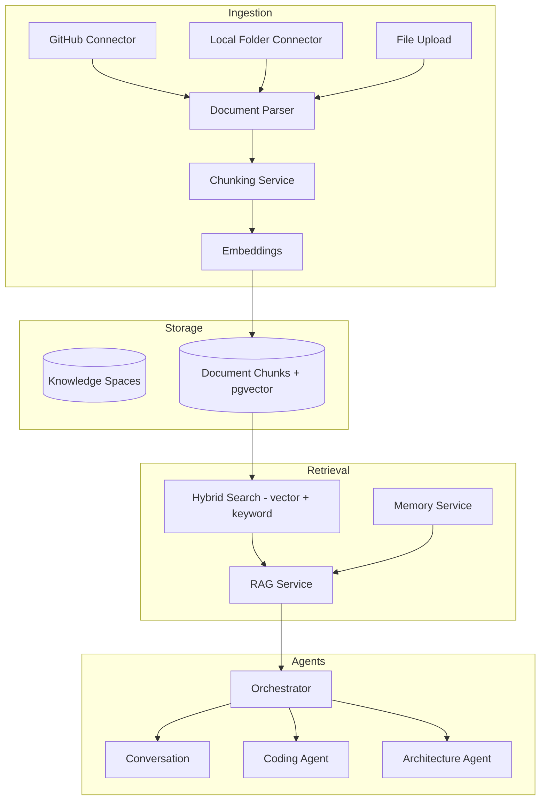

# Phase 2 — Knowledge Base, RAG, Agents & Orchestrator

## Overview

Phase 2 adds a production-grade RAG knowledge base, specialized agents, and an intent-routing orchestrator integrated with the existing memory system.

## Architecture



## Knowledge Base

### Knowledge Spaces
Project-scoped containers for indexed knowledge. Each space holds sources, documents, and chunks.

### Sources
| Type | Config | Features |
|------|--------|----------|
| `local_folder` | `{ "path": "/abs/path" }` | Walk directory, skip node_modules/.git |
| `github` | `{ "repo": "owner/name", "branch": "main" }` | GitHub API, SHA-based change detection |
| `upload` | — | PDF, DOCX, MD, TXT, code files |

### Supported Formats
PDF (pypdf), DOCX (python-docx), Markdown, plain text, source code (50+ extensions)

### Hybrid Retrieval
- **65%** vector similarity (pgvector cosine)
- **35%** full-text search (PostgreSQL tsvector)
- Conversation-aware query expansion (last 3 user messages)
- Memory integration (top memories merged into RAG results)

### File Change Detection
Background `SourceWatcher` polls every 60s (configurable). Compares file mtimes (local) or Git SHAs (GitHub) and re-indexes on change.

## Agents

### Orchestrator
Routes messages by intent detection (regex patterns). Supports manual override via `agent` parameter.

| Agent | Triggers | Capabilities |
|-------|----------|--------------|
| `conversation` | Default | General MOBIUS personality + RAG context |
| `coding` | code, implement, fix, debug, languages | Repo-aware answers, cites file paths |
| `architecture` | architecture, scalability, diagrams, trade-offs | Design review, Mermaid diagrams |
| `research` | research, summarize, compare, docs | RAG-heavy retrieval |

### API Endpoints

```
POST /api/v1/knowledge/spaces
POST /api/v1/knowledge/spaces/{id}/sources/local
POST /api/v1/knowledge/spaces/{id}/sources/github
POST /api/v1/knowledge/sources/{id}/ingest
POST /api/v1/knowledge/spaces/{id}/upload
POST /api/v1/knowledge/search
POST /api/v1/agents/run
POST /api/v1/agents/coding
POST /api/v1/agents/architecture
POST /api/v1/agents/classify
```

## Database (Migration 002)

New tables: `knowledge_spaces`, `knowledge_sources`, `documents`, `document_chunks`, `ingestion_jobs`

## Configuration

```env
GITHUB_TOKEN=ghp_...          # Required for private repos
KNOWLEDGE_STORAGE_PATH=./data/knowledge
CHUNK_SIZE=1000
CHUNK_OVERLAP=200
WATCHER_POLL_INTERVAL_SECONDS=60
HYBRID_VECTOR_WEIGHT=0.65
HYBRID_KEYWORD_WEIGHT=0.35
```

## Testing

26 unit tests covering chunking, parsing, orchestrator intent, auth, and idea detection.

```bash
cd backend && pytest tests/unit/ -v
```
