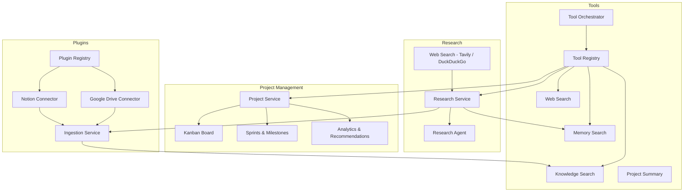

# Phase 3 — Research Agent, Integrations, Project Management & Tool Orchestrator

## Overview

Phase 3 extends MOBIUS with web research, external knowledge connectors, AI-powered project management, and multi-step tool orchestration—all integrated with memory and the knowledge base.

## Architecture



## Research Agent

| Capability | Endpoint / Agent |
|------------|------------------|
| Web research with citations | `POST /api/v1/research` |
| Multi-source comparison | `POST /api/v1/research/compare` |
| Competitor analysis | `POST /api/v1/research/competitors` |
| AI paper analysis | `POST /api/v1/research/paper` |
| Document summarization | `POST /api/v1/research/summarize` |
| Chat agent mode | `agent=research` in chat |

Findings can be auto-stored to long-term memory and indexed in the knowledge base when `store_findings=true`.

### Web Search Providers

1. **Tavily** (preferred) — set `TAVILY_API_KEY`
2. **DuckDuckGo** — automatic fallback

## Plugin Connectors

Built-in plugins register at startup via `register_builtin_plugins()`:

| Plugin | Source Type | Config |
|--------|-------------|--------|
| Notion | `notion` | `NOTION_API_KEY`, database ID per source |
| Google Drive | `google_drive` | `GOOGLE_DRIVE_ACCESS_TOKEN`, folder ID per source |

All synced content flows through the standard ingestion pipeline (chunk → embed → hybrid index).

API:
- `POST /api/v1/knowledge/spaces/{id}/sources/notion`
- `POST /api/v1/knowledge/spaces/{id}/sources/gdrive`
- `GET /api/v1/plugins`

## Project Management

Database migration `003_project_management.py` adds sprints, milestones, and Kanban columns.

| Feature | API |
|---------|-----|
| Projects CRUD | `/api/v1/projects` |
| Kanban board | `/api/v1/projects/{id}/kanban` |
| Task move | `PATCH /api/v1/tasks/{id}/move` |
| Sprints | `/api/v1/projects/{id}/sprints` |
| Milestones | `/api/v1/projects/{id}/milestones` |
| Analytics | `/api/v1/projects/{id}/analytics` |
| Recommendations | `/api/v1/projects/recommendations` |

Frontend: `/projects` — Kanban, roadmap, analytics tabs with sprint/milestone creation.

## Tool Orchestrator

Coordinates multi-step plans for complex requests:

```
memory_search → knowledge_search → web_search → project_summary → store_finding
```

Triggered automatically when chat messages match complex patterns (e.g. "research and compare X with Y").

Tools available:
- `memory_search` — user preferences and context
- `knowledge_search` — indexed documents
- `web_search` — current web results
- `project_summary` — tasks, sprints, milestones
- `research` — deep research with citations
- `store_finding` — persist insights to memory

API: `POST /api/v1/research/orchestrate`

## Configuration

```env
TAVILY_API_KEY=           # Web search (recommended)
NOTION_API_KEY=           # Notion integration
GOOGLE_DRIVE_ACCESS_TOKEN= # Google Drive integration
```

## Security

- Plugin tokens stored per-source in encrypted config JSON; env vars used as defaults
- All project/research endpoints require JWT authentication
- User-scoped data isolation on tasks, sprints, milestones, and findings

## Testing

```bash
cd backend && pytest tests/unit/test_research.py tests/unit/test_tool_orchestrator.py -v
```
